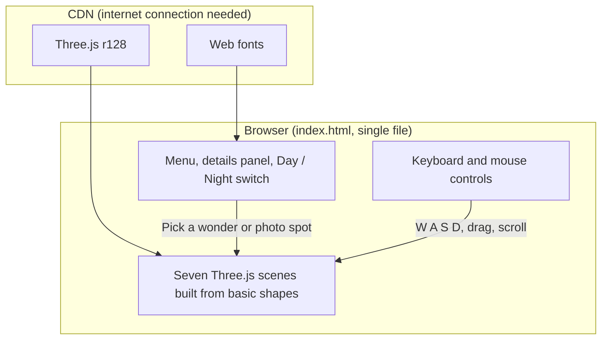

<div align="center">

# 🌎 Seven Wonders in 3D
### Walk Around the Seven Wonders of the World in Your Browser

[](https://kiranjitdesign.github.io/7-wonders-of-the-world/)
[](https://threejs.org/)
[](https://developer.mozilla.org/en-US/docs/Web/HTML)
[](#-run-it)

*An interactive 3D explorer for the seven wonders of the world. Pick a wonder, walk around it with the keyboard, zoom in for a closer look, and read quick travel details for each one.*

[Live Demo](https://kiranjitdesign.github.io/7-wonders-of-the-world/) • [Features](#-features) • [Controls](#-controls) • [The Wonders](#-the-wonders) • [How It Works](#-how-it-works) • [Run It](#-run-it) • [Notes](#-notes)

</div>

---

## ✨ Features

- 🏛️ **Seven 3D scenes:** Each wonder is built from simple shapes in Three.js.
- 🚶 **Walk around:** Move around each wonder with `W` `A` `S` `D`.
- 🖱️ **Look and zoom:** Drag to look around and scroll to zoom in for a closer look.
- 🌗 **Day and night view:** Switch to night to see stars and a moon.
- 🧳 **Travel details panel:** Every wonder has a details panel you can close with ✕, and a ✓ appears in the menu for wonders you have visited.
- 📸 **Go to photo spot:** One button jumps to each wonder's best viewpoint.

---

## 🎮 Controls

| Action | Input |
| :--- | :--- |
| Choose a wonder | Menu, or keys `1` to `7` |
| Move | `W` `A` `S` `D` |
| Go down / up | `Q` / `E` |
| Sprint | `Shift` |
| Look around | Click and drag |
| Zoom | Mouse wheel |
| Day / night | `N`, or the Day / Night switch |

---

## 🌍 The Wonders

| # | Wonder | Ideal booking window | Essential gear | Prime photo spot |
| :---: | :--- | :--- | :--- | :--- |
| 1 | **Great Wall** | 1–2 weeks ahead | Sturdy hiking shoes | Mutianyu Watchtower 20 |
| 2 | **Petra** | Look into Jordan Pass | Flashlight / Headlamp | High Place of Sacrifice |
| 3 | **Christ the Redeemer** | 2–4 weeks ahead | Sunglasses / Hat | Base of the statue pedestal |
| 4 | **Machu Picchu** | 3–6 months ahead | Passport (required for entry) | Watchman’s Hut |
| 5 | **Chichén Itzá** | Day-of available | Biodegradable sunscreen | El Castillo front plaza |
| 6 | **Colosseum** | 30 days ahead (strict) | Shoulder/knee coverings | Upper tier overlooking the arena |
| 7 | **Taj Mahal** | 1–3 days ahead | Shoe covers (provided) | Yamuna riverbank (Mehtab Bagh) |

---

## 🧱 How It Works



---

## 🚀 Run It

No install or build step is needed.

1. Download or clone this repo:
   ```bash
   git clone https://github.com/KiranJITdesign/7-wonders-of-the-world.git
   cd 7-wonders-of-the-world
   ```
2. Open `index.html` in a modern browser.

> 💡 An internet connection is needed because Three.js and the fonts load from a CDN.

Or skip setup and open the **[live demo](https://kiranjitdesign.github.io/7-wonders-of-the-world/)**.

---

## 🧰 Built With

- [Three.js](https://threejs.org/) (r128)
- Plain HTML, CSS and JavaScript in a single file

---

## 📝 Notes

The models are stylised and made from basic geometry, not photoreal scans. Travel details such as booking windows are general guidance, so check the official sites before you go.
