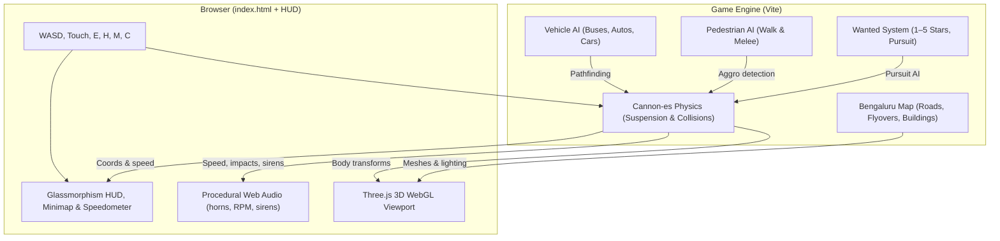

🌆 Namma Bengaluru GTA

Bengaluru: City of Dreams

https://img.shields.io/badge/3D_Engine-Three.js-ec4899?style=for-the-badge&logo=threedotjs&logoColor=white
https://img.shields.io/badge/Physics-Cannon--es-6366f1?style=for-the-badge
https://img.shields.io/badge/Build-Vite-646cff?style=for-the-badge&logo=vite&logoColor=white
https://img.shields.io/badge/Audio-Web_Audio_API-orange?style=for-the-badge

An open-world 3D action-adventure game set in the bustling streets of Bengaluru. Drive BMTC buses, dodge traffic, hijack vehicles, and trigger high-speed police chases — all in your browser.

Features • Controls • Vehicles & Landmarks • How It Works • Run It • Troubleshooting • Notes

---

✨ Features

· 🏙️ Authentic Bengaluru Map: Dr. B.R. Ambedkar Road, Malleshwaram, Silk Board & Hebbal flyovers, Cubbon Park, fuel stations, and tech parks.
· 🚌 Iconic Drivable Vehicles: Sedans, sports cars, auto-rickshaws, and BMTC buses (Routes 335E & 500D).
· 🛞 Dynamic Vehicle Physics: Realistic acceleration, drift/braking, reverse gear, weight distribution, and steering.
· 🤼 Pedestrian AI & Retaliation: Bump into residents and they'll fight back with street melee combat.
· 🚨 5-Star Wanted System: Smash barricades or civilians to alert Karnataka Police — pursuit AI, flashers, and sirens included.
· 💀 Classic "WASTED" Screen: Triggers on fatal impacts or zero health.
· 🗺️ Interactive City Map: Press M to see live GPS markers, landmarks, and zoom across the district.
· 🔊 Synthetic 3D Audio: Custom-synthesized horns, RPM, crashes, and Doppler-effect sirens — no external audio files.

---

🎮 Controls

Action Keyboard Touch / On-Screen
Move / Drive W A S D or Arrow Keys ▲ ▼ ◀ ▶
Sprint Shift —
Jump / Handbrake Space HANDBRAKE
Enter / Exit Vehicle E [E] DRIVE / [EXIT]
Enlarge City Map M Tap Minimap
Horn H 📢 HORN
Camera View (1st / 3rd person) C —
Pause Esc —

---

🚗 Vehicles & Landmarks

Vehicle Class Top Speed Horn Notes
Sedan Civilian Moderate Standard Great all-rounder
Sports Car Performance High Sharp beep Best for police chases
Auto-Rickshaw Three-wheeler Low Classic auto horn Tight turning radius
BMTC Bus 335E Transit Low Pneumatic air horn Heavy, high momentum
BMTC Bus 500D Transit Low Pneumatic air horn Longest vehicle in the game

Landmark Type Best Moment to Visit
Cubbon Park Green space Walk around on foot
Silk Board Flyover Elevated road High-speed drift challenge
Hebbal Flyover Elevated road Night lights view
Malleshwaram Neighborhood Pedestrian encounters
Tech Park Commercial zone Fast traffic to weave through

---

🧱 How It Works



---

🚀 Run It

Prerequisites: Node.js v16+, npm, and a WebGL2-compatible browser.

1. Clone the repo:
   ```bash
   git clone https://github.com/KiranJITdesign/nama-banglore-gta-game.git
   cd nama-banglore-gta-game
   ```
2. Install and launch:
   ```bash
   npm install
   npm run dev
   ```
3. Open http://localhost:3000/ (or the URL printed in your terminal).

Production build:

```bash
npm run build
npm run preview
```

---

📂 Repository Structure

```
nama-banglore-gta-game/
├── public/              # Static assets, textures, UI icons
├── src/
│   ├── audio/           # Procedural Web Audio synthesizers
│   ├── entities/        # Player, Pedestrian, Vehicle classes
│   ├── physics/         # Cannon-es world & colliders
│   ├── world/           # Three.js map, roads, buildings, lighting
│   ├── ui/              # Canvas HUD, cockpit, minimap
│   └── main.js          # Main game loop
├── index.html
├── package.json
├── vite.config.js
└── README.md
```

---

🧰 Built With

· Three.js — PBR 3D rendering
· Cannon-es — Rigid body physics
· Vite — Dev server & bundler
· Web Audio API — Procedural sound
· HTML5 Canvas — HUD and minimap

---

🧰 Troubleshooting

Problem Fix
Low FPS / Stuttering Enable Hardware Acceleration in browser settings (chrome://settings/system).
No sound Click the canvas once — browsers block audio until user interaction.
Physics clipping / falling through map Reload the scene; check src/main.js substep settings.

---

📝 Notes

The map is a stylized tribute to Bengaluru, not a photoreal replica. Runs best on desktop GPUs with WebGL2 support. Performance can be tuned in src/main.js.
